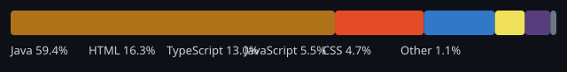

# Hi, I'm Zaid Mushtaq

**Software Developer** · Bengaluru, India · [OneBill Software Private Limited](https://github.com/zaid-mushtaq-software-engineer)

Software Developer | Backend Engineering | AI Enthusiast

---

## About Me

I'm a Software Developer interested in building reliable backend applications and scalable systems. My primary interests include Java, Spring Boot, database technologies, backend architecture, and distributed systems.

I'm also exploring AI engineering, LLMs, Model Context Protocol (MCP), and Agentic AI, with a focus on integrating AI into modern software applications.

---

## Technical Skills

### Programming

### Backend Development

### Databases

### Messaging

### System Design

High-Level Design (HLD) · Low-Level Design (LLD) · Distributed Systems

### Tools

### AI

Large Language Models (LLMs) · Model Context Protocol (MCP) · AI Agents · Agentic AI

---

## Engineering Interests

- Backend Architecture
- Distributed Systems
- Scalability and Performance
- Database Design
- AI-powered Applications

---

## Featured Projects

### [KINNOTE](https://github.com/zaid-mushtaq-software-engineer/KINNOTE)

**Family Story Archive** — a private platform to preserve family memories through photos, stories, and personal connections.

| | |
|---|---|
| **Problem** | Centralize family memories with controlled sharing (followers and private groups) instead of scattered chats and albums. |
| **Stack** | Java 21, Spring Boot 3, MySQL, Redis, RabbitMQ, React, TypeScript, Vite |
| **Status** | Active development (private repository) |

**Implemented highlights (verified in-repo):**

- Split **`api`** and **`worker`** Spring profiles (REST + security vs. outbox relay and RabbitMQ consumers)
- Flyway-backed MySQL schema, Redis for caching/session patterns, object storage via MinIO in local dev
- React + Vite frontend with `/rest/v1` API proxy

**Architecture:** Modular Spring Boot backend with transactional outbox, async consumers, and a React SPA. See repository docs for flow and API reference.

---

### [Redis Engineering Lab](https://github.com/zaid-mushtaq-software-engineer/redis-engineering-lab)

A **hands-on Redis laboratory** on a Product & Inventory domain—MySQL as source of truth, Redis as an optional performance layer.

| | |
|---|---|
| **Problem** | Learn production-style caching, invalidation, and rate limiting with measurable failure modes. |
| **Stack** | Java 21, Spring Boot 3.5, MySQL 8, Redis 7.2, Docker Compose, Flyway, Testcontainers |
| **Status** | Phase 1 complete (documented baseline); Phase 2 planning in roadmap |

**Implemented highlights (verified in-repo):**

- **13** business HTTP endpoints (product & inventory admin + public reads)
- Cache-aside for product detail, paginated lists, and inventory (TTL + invalidation after commit)
- Per-IP **token-bucket rate limiting** (Lua in Redis) on public GETs
- Integration tests with Testcontainers; dev-only Redis sandbox behind admin key

**Architecture:** Layered Spring Boot services, explicit cache services, `SCAN`-based list eviction (no `KEYS`), fail-open when Redis is unavailable.

---

## GitHub Statistics

### Most Used Languages

*Distribution reflects **aggregated code volume** across repositories I own (public and private), not skill level. Updated automatically—see [workflow setup](docs/GH_STATS_SETUP.md).*

### Contribution Activity

### GitHub Statistics

### Contribution Streak

---

## Currently Exploring

*Learning focus—not all items below appear in shipped projects yet.*

- Advanced Java and Spring Boot
- System Design
- Redis and Distributed Systems
- RabbitMQ and Apache Kafka
- AI Engineering
- LLMs, MCP, and Agentic AI

---

## Connect With Me

